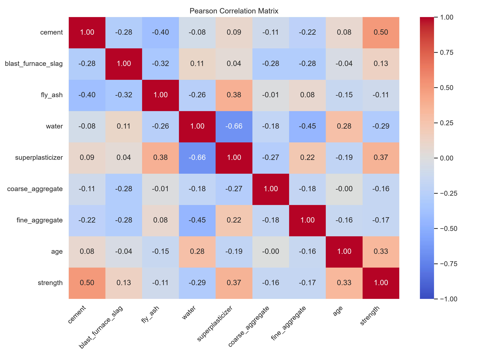
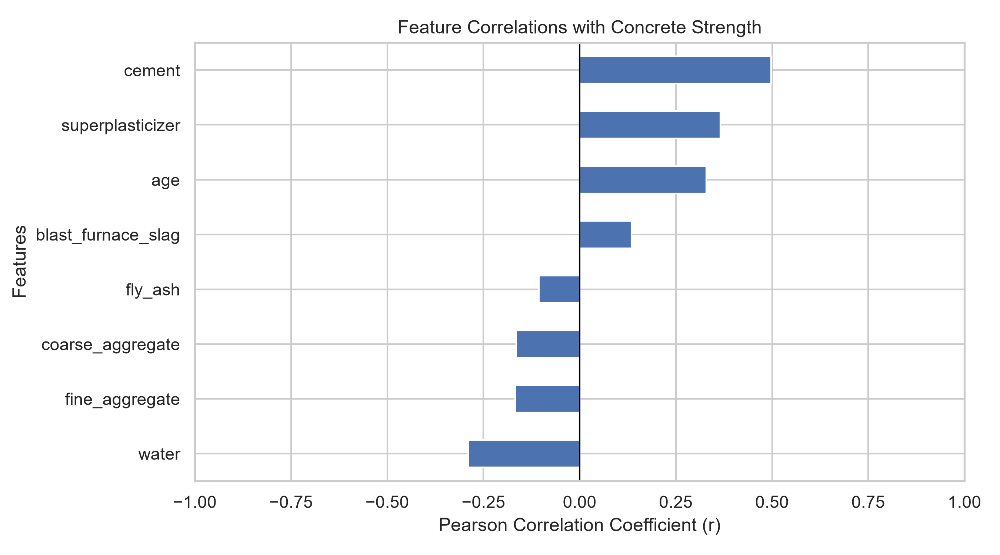

# Concrete Strength: Statistical Analysis and Prediction

## Project Overview

This project investigates how concrete ingredients and curing age relate to compressive strength, builds machine-learning models to predict strength, and evaluates when those predictions are reliable.

### Main Goals

1. **Statistical Analysis:** Investigate which features are associated with higher or lower concrete strength.
2. **Machine Learning:** Predict concrete strength using Linear Regression, Ridge Regression, and Random Forest.
3. **Model Reliability:** Analyze errors and identify situations where predictions are less dependable.

## Dataset

This project uses the Concrete Compressive Strength dataset from the UCI Machine Learning Repository.

- **Author:** I-Cheng Yeh
- **Instances:** 1,030
- **Input features:** 8
- **Target:** Concrete compressive strength (MPa)
- **License:** CC BY 4.0

### Citation

Yeh, I. (1998). *Concrete Compressive Strength* [Dataset]. UCI Machine Learning Repository.

https://doi.org/10.24432/C5PK67

## Data Quality & Preprocessing

The dataset was examined for missing values, duplicate records, invalid measurements, and potential outliers.

### Key Findings

| Quality Check | Result |
|---|---|
| Total observations | 1,030 |
| Missing values | 0 |
| Exact duplicate rows | 25 |
| Negative values | 0 |
| Invalid age values | 0 |
| Invalid strength values | 0 |
| Cement outliers | 0 |
| Water outliers | 9 |
| Age outliers | 59 |
| Strength outliers | 4 |

*Potential outliers were identified using the 1.5 × IQR method for Cement, Water, Age, and Strength.*

### Preprocessing Decisions

- Standardized column names for easier analysis.
- Verified numerical data types and basic measurement validity.
- Retained all 1,030 observations.
- Preserved potential outliers because unusual values are not necessarily errors.
- Retained exact duplicates for further investigation before model training.
- Preserved the original dataset without modification.

### Processed Dataset

The prepared dataset is available at `data/processed/concrete_clean.csv`.

**Final shape:** 1,030 rows × 9 columns.

### Detailed Analysis

The complete data quality investigation, Python code, and results are available in [Task 02 — Data Quality Checking](notebooks/02_data_quality.ipynb).

## Exploratory Data Analysis (EDA)

Exploratory Data Analysis was performed to understand the distributions of concrete ingredients, curing age, and compressive strength.

### Analysis Performed

- Descriptive statistical analysis
- Concrete strength distribution analysis
- Ingredient distribution analysis
- Curing age distribution analysis
- Scatter plots of input features against strength
- Concrete strength comparison across selected ages

### Key Findings

- **Strength Distribution:** Most concrete samples have compressive strengths between approximately 20 and 45 MPa.
- **Cement:** Higher cement quantities generally correspond to higher concrete strengths.
- **Water:** Higher water quantities generally correspond to lower concrete strengths.
- **Curing Age:** Older concrete samples tend to exhibit higher median strengths.
- **Ingredient Distributions:** Slag, fly ash, and superplasticizer are absent from many mixtures.
- **Age Distribution:** The most common curing age is 28 days, with 425 samples.
- **Variability:** Concrete strength varies considerably across different mixtures and curing ages.

*These findings are based on exploratory visualizations and do not establish causal relationships.*

### Visualizations

The following visualizations were generated:

1. Concrete Strength Distribution
2. Ingredient Distributions
3. Curing Age Distribution
4. Feature vs. Strength Scatter Plots
5. Concrete Strength by Curing Age

Generated figures are available in [`reports/figures/`](reports/figures/).

### Detailed Analysis

The complete EDA, visualizations, Python code, and interpretations are available in [Statistical Analysis Notebook](notebooks/03_statistical_analysis.ipynb).

## Correlation Analysis

Pearson correlation analysis was used to quantify linear relationships between concrete ingredients, curing age, and compressive strength.

### Analysis Performed

- Calculated the Pearson correlation matrix and visualized it with a heatmap.
- Ranked the eight input features by their correlations with strength.
- Examined relationships between ingredient quantities.
- Compared correlation results with and without 25 exact duplicate rows.

### Key Findings

| Feature | Pearson r with Strength |
|---|---:|
| Cement | +0.4978 |
| Superplasticizer | +0.3661 |
| Age | +0.3289 |
| Blast Furnace Slag | +0.1348 |
| Fly Ash | -0.1058 |
| Coarse Aggregate | -0.1649 |
| Fine Aggregate | -0.1672 |
| Water | -0.2896 |

- **Strongest positive correlation:** Cement (r = +0.4978).
- **Strongest negative correlation:** Water (r = -0.2896).
- **Weakest absolute correlation:** Fly Ash (r = -0.1058).
- **Notable feature-to-feature relationship:** Water vs. Superplasticizer (r = -0.657).
- **Duplicate sensitivity:** Removing 25 exact duplicates changed each correlation by less than approximately 0.032; the signs of all correlations stayed the same.

*These are exploratory linear associations, not causal effects. The original dataset was preserved; exact duplicates must be handled carefully during predictive evaluation.*

### Visualizations

### Detailed Analysis

Code, tables, plots, and interpretations are provided in [Statistical Analysis Notebook — Task 04](notebooks/03_statistical_analysis.ipynb).

### Next Step

**Task #05 — Statistical Modelling & Interpretation** will investigate how ingredients and curing age relate to strength when modeled together.

